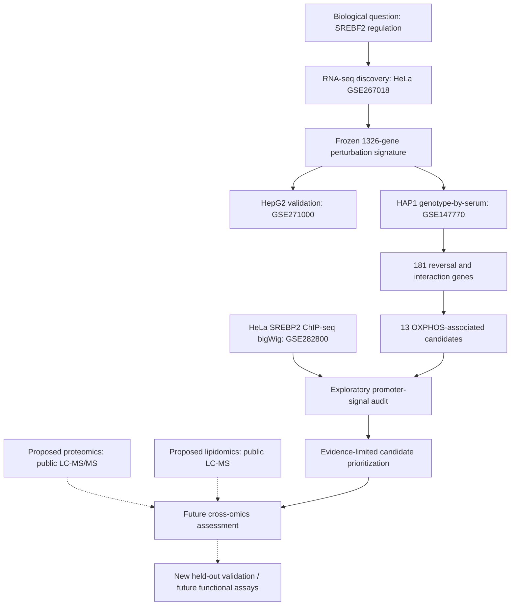

# Integrative Multi-Omics Investigation of SREBF2 Regulatory Responses

**A reproducible, public-data-driven study of context-dependent SREBF2/SREBP2 transcriptional regulation, promoter-associated epigenomic signal, and proposed proteomic and lipidomic validation**

[](https://github.com/mtariqi/srebf2-regulatory-signature)


**Repository:** https://github.com/mtariqi/srebf2-regulatory-signature  
**Research update:** 12 October 2026  
**Research approach:** Integrative multi-omics *framework*, with completed transcriptomic analyses and exploratory ChIP-seq-derived promoter-signal integration; proteomics, lipidomics, and laboratory assays are proposed rather than performed.  
**Current stage:** Computational results consolidated; manuscript preparation and reproducibility audit.

> **Evidence boundary:** The frozen 1,326-gene signature is **perturbation-derived, not confirmed binding-supported**. Promoter bigWig coverage is descriptive signal, not peak-level proof of SREBP2 occupancy. The 13 oxidative-phosphorylation (OXPHOS) genes are *computational candidates*, not confirmed direct targets. No proteomic, lipidomic, Seahorse, RT-qPCR, or binding-validation experiments have been performed. The signature has **not** been demonstrated to consistently outperform SREBF2 transcript abundance.

## Executive summary

**SREBF2** encodes **SREBP2**, a sterol-sensitive transcription factor involved in cholesterol biosynthesis and uptake. Sterol-dependent processing and nuclear translocation separate active SREBP2 from the abundance of its encoding mRNA. This project investigates whether a frozen perturbation-derived transcriptional signature captures SREBF2-associated responses across cell lines and conditions, and how transcriptomic responses relate to epigenomic promoter signal and prospective downstream protein/lipid phenotypes.

The HeLa discovery dataset **GSE267018** yielded a frozen **1,326-gene** candidate signature (795 decreased in knockout, 531 increased in knockout). Independent HepG2 shRNA data (**GSE271000**) showed mixed transferability: the signature decreased in two of three hairpin groups, whereas SREBF2 RNA was reduced in all three. In HAP1 **GSE147770**, signature responses changed direction between serum conditions. A genotype-by-serum DESeq2 analysis identified **5,308** Wald-significant interaction genes, and **181** mapped signature genes satisfied both the expected directional-reversal criterion and interaction FDR < 0.05. The 181-gene set was enriched for the **Hallmark oxidative phosphorylation** gene set (13 overlapping genes; BH-adjusted pathway p = **6.149296 × 10⁻⁵**).

Promoter-signal auditing against **GSE282800** identified nonzero promoter coverage for all 13 OXPHOS candidates, but expression- and biotype-matched comparisons did **not** establish a consistent binding-signal advantage. The primary finding is therefore **context-dependent SREBF2-associated transcriptional remodeling**, not a demonstrated direct mitochondrial regulatory mechanism.

## 1. Scientific rationale and research gap

Cholesterol homeostasis involves coordinated transcriptional and post-transcriptional regulation. SREBP2 responds to cellular sterol status through processing and nuclear localization, making **SREBF2 mRNA alone an incomplete candidate proxy for active SREBP2**. Differentially expressed genes after SREBF2 knockout or knockdown can be direct, indirect, compensatory, or context-dependent. Epigenomic occupancy, protein abundance, and lipid phenotypes would provide complementary evidence, but their measurement and interpretation require distinct assays and controls.

**Research gap:** How transferable are SREBF2 perturbation-derived signatures across cell lines and nutrient conditions, and can regulatory evidence and downstream molecular measurements distinguish robust effects from context-specific or indirect transcriptional responses?

**Primary computational research question:** Can a frozen perturbation-derived SREBF2 transcriptional signature capture SREBF2-associated responses more consistently than SREBF2 RNA expression alone across independent datasets?

**Updated, results-informed question:** Which SREBF2-associated transcriptional responses depend on serum context, and what evidence links the strongest reversal candidates to mitochondrial pathways and promoter-associated epigenomic signal?

The original benchmarking hypothesis remains **unproven**; the context-dependent findings are an observed outcome, not a post hoc assertion of predictive superiority.

## 2. Objectives, hypotheses, and specific aims

### Aim 1 — Transcriptomic discovery and external validation (completed)

- Fit differential-expression models for HeLa SREBF2 knockout versus wild type under FBS and cholesterol depletion.
- Freeze a direction-aware perturbation signature before external evaluation.
- Test transferability in independent HepG2 shRNA and HAP1 knockout datasets, preserving inconsistent results.
- Quantify genotype × serum interaction, directional reversal, and pathway enrichment.

**Hypothesis H1:** A subset of SREBF2-responsive genes shows reproducible directionality, but the global signature is modified by cell type, perturbation modality, and nutrient context.

### Aim 2 — Epigenomic Integration (Partially Completed)

**Objective:** Integrate SREBF2 perturbation-derived transcriptomic signatures with epigenomic evidence to identify candidate regulatory relationships and assess context-dependent transcriptional responses.

**Completed analyses:**
- Audited publicly available SREBP2 ChIP-seq/CUT&RUN resources and associated metadata.
- Quantified HeLa SREBP2 ChIP-seq-derived promoter bigWig signals near transcription start sites.
- Compared promoter signals with expression- and biotype-matched background genes.
- Evaluated the 13 OXPHOS-associated candidates identified through the HAP1 interaction analysis.

**Proposed epigenomic extension:**
- Prioritize CUT&Tag for future SREBP2 occupancy profiling, contingent on antibody validation.
- Profile H3K27ac and H3K4me3 to characterize active regulatory chromatin.
- Perform peak calling, replicate concordance analysis, motif enrichment, and peak-to-gene annotation using suitable public or newly generated datasets.
- Integrate credible occupancy evidence with the frozen 1,326-gene signature and the 181 context-dependent HAP1 directional-reversal candidates.

**Hypothesis H2:** A subset of transcriptionally responsive genes may exhibit SREBP2-associated regulatory occupancy. Existing ChIP-seq bigWig promoter coverage alone does not establish direct binding or transcriptional regulation.

**Status:** RNA-seq, exploratory ChIP-seq promoter-signal analysis, and independent public H3K27ac CUT&Tag peak-overlap integration completed. SREBP2-specific CUT&Tag experiments and direct-binding validation remain proposed.

### Proposed Epigenomic Method: CUT&Tag

**Cleavage Under Targets and Tagmentation (CUT&Tag)** is proposed as the primary low-input epigenomic profiling approach for investigating SREBP2-associated chromatin occupancy and regulatory histone modifications.

#### Experimental objectives

1. Assess whether SREBP2 occupies regulatory regions associated with genes responding to SREBF2 perturbation.
2. Characterize H3K27ac-associated active regulatory regions and H3K4me3-associated promoter chromatin.
3. Integrate chromatin profiles with the frozen 1,326-gene SREBF2 transcriptional signature and 181 context-dependent HAP1 directional-reversal candidates.
4. Prioritize regulatory hypotheses involving mitochondrial and cholesterol-homeostasis pathways.

#### Proposed experimental design

A factorial study will compare wild-type and SREBF2-deficient cells under defined sterol-replete and sterol-depleted conditions, with at least three independent biological replicates per group as an initial design target. Replicate numbers will be reassessed according to feasibility and statistical requirements.

CUT&Tag assays will target:

- **SREBP2:** Candidate transcription-factor occupancy, contingent on validated antibody specificity and suitable assay performance.
- **H3K27ac:** Active enhancer- and promoter-associated chromatin.
- **H3K4me3:** Promoter-associated chromatin states.

Appropriate negative controls, positive-control loci, and SREBF2-deficient controls will be incorporated. SREBP2 antibody suitability must be established before treating the assay as a reliable occupancy measurement.

#### Proposed computational workflow

1. Perform FASTQ quality assessment using FastQC and MultiQC.
2. Align sequencing reads to the appropriate reference genome using Bowtie2 or another validated aligner.
3. Assess alignment quality, fragment-size distributions, background signal, library complexity, and replicate concordance.
4. Identify enriched regions using a CUT&Tag-appropriate peak-calling workflow with assay-specific parameters and background controls.
5. Annotate peaks relative to transcription start sites, promoters, and distal regulatory regions.
6. Compare regulatory profiles between experimental conditions, accounting for biological replication and normalization.
7. Integrate candidate regulatory regions with DESeq2 results, pathway enrichment, and the frozen SREBF2 signature.
8. Evaluate candidate genes using prespecified genomic backgrounds and sensitivity analyses.

#### Interpretation and limitations

SREBP2-specific CUT&Tag enrichment would provide evidence of candidate chromatin occupancy, but would not independently prove direct transcriptional regulation. H3K27ac and H3K4me3 signals describe chromatin states rather than SREBP2 binding.

The existing GSE282800 ChIP-seq promoter-signal analysis remains an exploratory, separate evidence layer. Existing public CUT&RUN and ChIP-seq datasets retain their original assay labels.

**Status:** The SREBP2-specific CUT&Tag experimental design remains proposed. Separately, public HepG2 H3K27ac CUT&Tag data (GSE228074) have been computationally analyzed for exploratory chromatin-context integration; no new laboratory CUT&Tag experiments have been performed.
### Aim 3 — Proteomic and lipidomic consequences (proposed)

- Locate compatible public LC-MS/MS proteomics and lipidomics datasets, prioritizing matched SREBF2 perturbations and nutrient conditions.
- If suitable datasets exist, assess differential protein abundance, lipid/sterol changes, pathway concordance, and missingness/batch effects.
- If suitable data are absent, document a prospective experimental design rather than fabricating an integrated result.

**Hypothesis H3:** A subset of transcriptomic responses propagates to protein and lipid phenotypes; buffering and discordance are plausible alternatives.

### Aim 4 — Multi-omics model benchmarking (proposed)

Compare a newly specified integration model with SREBF2 RNA abundance, the **unchanged** frozen signature, and prespecified sterol-pathway scores in **additional held-out data**. Any model developed after inspecting GSE271000/GSE147770 is exploratory until tested independently.

## 3. Multi-omics modalities and evidence status

| Layer | Assay and data type | Analysis strategy | Status | What can be concluded |
|---|---|---|---|---|
| Transcriptomics | Bulk RNA-seq; count matrices, DESeq2 log2FC and FDR | Differential expression, frozen signature scoring, interaction and reversal audits | **Completed** | Perturbation-associated transcriptional changes and context interactions |
| TF-focused epigenomics | SREBP2 ChIP-seq/CUT&RUN; bigWig coverage, ideally validated peaks | Promoter quantification, matched nulls, future peak/motif QC | **Promoter signal completed; peak-based target evidence not established** | Descriptive signal, not proof of direct binding |
| Chromatin-state epigenomics | H3K27ac ChIP-seq (GSE267019) | Chromatin-mark QC and regulatory-context analysis | **Dataset audited; integration proposed** | Active-chromatin context, not SREBP2-specific occupancy |
| Proteomics | Quantitative LC-MS/MS; peptide/protein intensities | Differential abundance, RNA–protein concordance, pathway analysis | **Proposed** | Potential downstream protein-level responses |
| Lipidomics | LC-MS lipid species, cholesterol/sterol assays | Normalization, lipid annotation, pathway-level shifts | **Proposed** | Potential metabolic/sterol consequences |

**Important distinction:** The current study has two analyzed data modalities (RNA-seq and ChIP-seq-derived promoter signal), but does **not** constitute a completed four-layer multi-omics integration.

## 4. Public datasets and design

| GEO accession | Cell line / material | Perturbation or treatment | Role | Caveat |
|---|---|---|---|---|
| [GSE267018](https://www.ncbi.nlm.nih.gov/geo/query/acc.cgi?acc=GSE267018) | HeLa | WT vs SREBP2 knockout; FBS vs cholesterol depletion; 3 replicates/group | Discovery and frozen signature | Interaction sensitive to sample exclusion |
| [GSE271000](https://www.ncbi.nlm.nih.gov/geo/query/acc.cgi?acc=GSE271000) | HepG2 | Control vs three SREBF2 shRNA hairpins; 2 samples/group | Independent external validation | Small groups and hairpin heterogeneity |
| [GSE147770](https://www.ncbi.nlm.nih.gov/geo/query/acc.cgi?acc=GSE147770) | HAP1 | WT vs SREBF2 KO; +FBS vs −FBS; 3 replicates/group for analyzed groups | Independent context and interaction analysis | Serum starvation is **not equivalent** to cholesterol depletion |
| [GSE282800](https://www.ncbi.nlm.nih.gov/geo/query/acc.cgi?acc=GSE282800) | HeLa | SREBP2 ChIP-seq signal under FBS/cholesterol depletion | Promoter bigWig signal audit | Coverage is not a validated peak set; different cell line/conditions from HAP1 |
| [GSE267019](https://www.ncbi.nlm.nih.gov/geo/query/acc.cgi?acc=GSE267019) | HeLa | H3K27ac ChIP-seq | Potential chromatin-state integration | H3K27ac is not SREBP2 binding |
| [GSE271001](https://www.ncbi.nlm.nih.gov/geo/query/acc.cgi?acc=GSE271001) | HepG2 | Candidate SREBP2 CUT&RUN resource | Future occupancy evaluation | Suitability/controls/peaks require verification |

### Key model distinctions

- **HeLa GSE267018:** `~ genotype * treatment`; treatment includes **cholesterol depletion**.
- **HAP1 GSE147770:** `~ genotype + serum + genotype:serum`, with WT and `plus_FBS` reference levels; `minus_FBS` is **serum starvation**, not HeLa cholesterol depletion.
- **HepG2 GSE271000:** descriptive small-sample hairpin-level scoring; do not interpret it as formal evidence of superior prediction.
- Gene mapping, background universes, multiple-testing adjustments, and input hashes are recorded in the versioned outputs.

## 5. Completed results

### 5.1 HeLa discovery and sensitivity analysis — GSE267018

**12 samples**, 17,158 tested genes; GENCODE v47 annotation. BH FDR < 0.05 counts below do **not** impose a log2FC cutoff.

| Contrast | FDR-significant genes | Increased in KO | Decreased in KO |
|---|---:|---:|---:|
| KO vs WT, cholesterol depletion | 6,387 | 3,105 | 3,282 |
| KO vs WT, FBS | 4,198 | 1,914 | 2,284 |
| Genotype × treatment interaction | 62 | 0 | 62 |
| KO vs WT, depletion, excluding SRR28966285 | 6,835 | 3,196 | 3,639 |
| KO vs WT, FBS, excluding SRR28966285 | 4,671 | 2,147 | 2,524 |
| Interaction, excluding SRR28966285 | 175 | 28 | 147 |

The interaction count's sensitivity to excluding `SRR28966285` must remain visible; the exclusion is a sensitivity analysis, not an automatically preferred primary model.

### 5.2 Frozen `discovery_v1` signature

Selection: cholesterol-depletion KO-vs-WT **padj < 0.05** and **|log2FC| ≥ 1**, concordant nonzero direction in FBS and the exclusion sensitivity analysis, exact annotation match, excluding SREBF2. FBS and sensitivity comparisons did not separately require significance.

| Signature component | Genes | Definition |
|---|---:|---|
| Positive | **795** | Decreased in SREBF2 KO |
| Negative | **531** | Increased in SREBF2 KO |
| **Total** | **1,326** | Frozen, perturbation-derived |

Frozen files: `results/signature/discovery_v1/`. The signature must not be silently reselected based on validation outcomes.

### 5.3 HepG2 external validation — GSE271000

Eight samples: two controls and two replicates for each of `shSREBP2_664`, `_665`, and `_667`. All **1,326** signature gene IDs had exact matches in the count matrix. Frozen direction-aware percentile scoring yielded:

| Group | Mean signature score | Difference from control | SREBF2 log2-normalized expression difference |
|---|---:|---:|---:|
| Control | 0.098951 | — | — |
| shSREBP2_664 | 0.089487 | −0.009463 | −1.680200 |
| shSREBP2_665 | 0.099560 | +0.000609 | −1.255098 |
| shSREBP2_667 | 0.088513 | −0.010438 | −2.474415 |

**Interpretation:** Expected signature direction in **2/3** hairpins, but SREBF2 RNA decreased in **3/3**. No established superiority of the signature. Later matched-null, sensitivity, and diagnostic analyses are preserved under `results/validation/GSE271000/` and `results/signature_validation/`; the discordant hairpin remains in the evidence record. Original read-layout metadata discrepancies are documented in the validation audit.

### 5.4 HAP1 external validation and interaction — GSE147770

The analysis used 12 WT/SREBF2-KO samples across +FBS and −FBS (three biological replicates per genotype × serum group). After auditing the supplied count matrix, the frozen signature mapped to **1,065 genes** (676 positive, 389 negative). The mapping is **not** 100%, unlike GSE271000.

- **15,363** genes tested in the DESeq2 interaction model.
- KO vs WT **+FBS:** **3,954** BH FDR < 0.05.
- KO vs WT **−FBS:** **7,729** BH FDR < 0.05.
- Genotype × serum **Wald interaction:** **5,308** BH FDR < 0.05.
- Interaction **LRT:** **5,309** BH FDR < 0.05.
- The Wald/LRT overlap is nearly complete (**5,308/5,309** union), but these are analyses of the **same samples**, not independent replication.

The aggregate signature score changed from a negative KO-minus-WT difference under +FBS to a positive difference under −FBS across four scoring methods; the positive component showed the most consistent reversal. These are **context-dependent signatures**, not evidence that knockout increases active SREBP2.

### 5.5 Directional reversal audit

| Component | Mapped | Both condition LFCs available | Expected reversal | Interaction FDR < 0.05 | Expected reversal **and** interaction FDR < 0.05 |
|---|---:|---:|---:|---:|---:|
| Positive | 676 | 573 | 175 | 270 | **131** |
| Negative | 389 | 284 | 82 | 89 | **50** |
| **Combined** | **1,065** | **857** | **257** | **359** | **181** |

The **181-gene** set is a selected subset of the frozen signature and the HAP1 interaction results. Selection criteria and tested backgrounds are documented in `results/validation/GSE147770/direction_audit_v1/`.

### 5.6 Pathway enrichment and OXPHOS robustness

Hallmark, Reactome, and GO Biological Process enrichment evaluated **5,647 pathways** using the documented gene universe and BH correction.

- Positive reversal subset (131 genes): **16** FDR-significant pathways.
- Negative reversal subset (50 genes): **0** FDR-significant pathways.
- Combined reversal subset (181 genes): **7** FDR-significant pathways.
- Top combined result: **HALLMARK_OXIDATIVE_PHOSPHORYLATION**, **13 overlapping genes**, fold enrichment **5.246426**, BH-adjusted p = **6.149296 × 10⁻⁵**.

Other significant combined results involve respiratory electron transport, aerobic respiration, ATP synthesis, and mitochondrial translation. The absence of FDR-significant lipid/stress pathways in this **selected reversal set** does not imply an absence of cholesterol-related effects elsewhere in the data.

**13 OXPHOS-associated reversal genes:** `NDUFB7`, `ETFB`, `COX6B1`, `POR`, `MRPS12`, `MRPL34`, `NDUFA2`, `TIMM10`, `NDUFS6`, `ATP5MC3`, `ATP5ME`, `UQCRH`, `ATP5MF`.

All 13 belonged to the positive component, had negative KO-vs-WT log2FC under +FBS and positive log2FC under −FBS, and met interaction FDR < 0.05. Sensitivity tests using all evaluable genes versus the mapped-signature universe retained OXPHOS enrichment; those individual-set sensitivity p-values are **nominal**, not pathway-wide FDR values.

### 5.7 Exploratory promoter-signal integration — GSE282800

The existing analysis summarized HeLa SREBP2 ChIP-seq-derived bigWig signal over promoters defined as approximately **TSS −2 kb to +500 bp**. All **13/13** OXPHOS genes had promoter coverage and nonzero signal in at least one analyzed track. **10/13** showed higher descriptive promoter signal under cholesterol depletion than FBS.

Exploratory unadjusted comparisons found a higher median FBS promoter signal for the 13 genes than for a broad signature control set (p ≈ **0.011**), but **expression- and biotype-matched 500-draw analyses did not establish a consistent promoter-signal advantage**. The promoter-signal difference between conditions was not enriched in the unmatched comparison (p ≈ **0.658**). These comparisons are exploratory, with multiple-comparison and cross-study limitations.

**Not demonstrated:** validated SREBP2 peaks at these promoters, differential occupancy, direct regulation, causal mitochondrial activity changes, or a binding-supported 13-gene signature. The ChIP-seq-derived HeLa signal is not a matched HAP1 serum-starvation assay.

### 5.8 RNA-based candidate prioritization

The Phase 6I ranking used only RNA evidence: equally weighted within-set percentile ranks of interaction significance (`−log10(padj)`) and reversal magnitude. **Promoter signal did not contribute to the score**.

| Priority | Candidate | RNA priority score | Evidence level |
|---:|---|---:|---|
| 1 | **ETFB** | 100.0 | Computational RNA reversal candidate |
| 2 | **TIMM10** | 88.46 | Computational RNA reversal candidate |
| 3 | **MRPS12** | 76.92 | Computational RNA reversal candidate |
| 4 | **NDUFB7** | 73.08 | Computational RNA reversal candidate |
| 5 | **ATP5MC3** | 73.08 | Computational RNA reversal candidate |

All 13 candidates appear in `results/validation/GSE147770/candidate_prioritization_v1/CANDIDATE_SHORTLIST_v1.tsv`. These scores are **relative rankings within the 13-gene set**, not calibrated probabilities or independent validation metrics.

## 6. Integrated evidence interpretation



**Interpretive hierarchy:** (1) measured differential expression and interaction; (2) enrichment among explicitly selected genes; (3) descriptive promoter coverage and matched null analyses; (4) candidate prioritization; (5) *proposed* protein/lipid and mechanistic validation. None of these layers should be conflated.

## 7. Proposed proteomics and lipidomics methods (instructor-required multi-omics component)

### 7.1 Public-data-first feasibility strategy

1. Search PRIDE/ProteomeXchange, MassIVE, MetaboLights, and Metabolomics Workbench for **SREBF2/SREBP2** knockout/knockdown, sterol depletion, and matched control datasets.
2. Screen organism, cell line, treatment, time point, biological replication, controls, raw/processed accessibility, and measurement modality.
3. Prefer the same biological conditions and time points as the RNA datasets; otherwise explicitly label cross-study comparisons as *nonmatched and descriptive*.
4. Predefine candidate-gene and pathway hypotheses before analyzing a new proteomic/lipidomic dataset.
5. If no suitable public dataset exists, retain the assay as a **proposed method** and do not create synthetic observations presented as experimental results.

### 7.2 Proteomics: proposed LC-MS/MS workflow

- **Design:** Matched WT and SREBF2-perturbed cells under sterol-replete/depleted conditions, independent biological replicates and randomized preparation order; prospective power based on pilot variance.
- **Acquisition:** Proteolytic digestion, LC-MS/MS with appropriate quantitative acquisition (DIA or validated label-free/TMT design), peptide and protein identification with target–decoy FDR control.
- **Quality control:** Protein coverage, missingness, batch effects, sample-level intensity distributions, replicate concordance, contamination, and identification confidence.
- **Analysis:** Normalization, differential protein abundance with suitable linear models, BH correction, mapping of proteins to frozen signature genes, RNA–protein concordance and pathway analysis.
- **Key endpoints:** Candidate protein changes, SREBP2 pathway proteins, respiratory-chain proteins, and concordance/discordance with the 13 OXPHOS-associated transcripts.
- **Alternative outcomes:** RNA changes without protein changes may reflect buffering, timing, or measurement limitations rather than failure of the transcriptomic analysis.

### 7.3 Lipidomics: proposed LC-MS workflow

- **Design:** Matched perturbation/treatment groups, biological replicates, extraction blanks, pooled QC, internal standards, and randomized run order.
- **Acquisition:** Targeted or untargeted LC-MS for lipid species; validated free and esterified cholesterol/sterol quantification where feasible.
- **Quality control:** Feature annotation confidence, retention-time stability, internal-standard recovery, QC coefficients of variation, drift, batch effects, and missingness.
- **Analysis:** Appropriate normalization and log-scale modeling, BH correction, class-level summaries, sterol-pathway interpretation, and sensitivity to compositional effects.
- **Key endpoints:** Cholesterol/sterol abundance, cholesterol esters, membrane-lipid composition, and potential metabolic signatures accompanying transcriptional remodeling.
- **Alternative outcomes:** Lipid stability despite transcript changes can reflect homeostatic compensation or a mismatch in timing.

### 7.4 Future cross-omics integration and safeguards

A future integrative model would combine **only genuinely measured and appropriately matched** RNA, occupancy, protein, and lipid features. Candidate approaches include pathway-level concordance, multiblock factor analysis, or a regularized activity model. Require explicit feature provenance, sample matching, missingness handling, batch control, and held-out evaluation. Do not interpret correlations across unmatched studies as causal effects or treat newly selected features as independently validated.

## 8. Phase 6J: experimental validation plan (not performed)

A proposed 2 × 2 genotype × serum design would test WT and SREBF2 KO under +FBS and −FBS, first confirming the original treatment duration and cell culture conditions. Candidate RT-qPCR endpoints include `ETFB`, `TIMM10`, `MRPS12`, `NDUFB7`, and `ATP5MC3`; a factorial interaction model and BH adjustment across the prespecified tests are planned. Orthogonal SREBP2 CUT&RUN/ChIP-qPCR, rescue, and Seahorse respiration assays would test binding and function **if funding and facilities become available**.

**No wet-lab assays are required to document the completed computational findings.** Protocol: [`protocols/phase6j/README.md`](protocols/phase6j/README.md).

## Phase 7–8: Public H3K27ac CUT&Tag Integration (Completed)

**Updated:** 17 October 2026

This exploratory analysis integrates the frozen SREBF2
transcriptional signature with an independent public H3K27ac
CUT&Tag dataset.

**Data provenance**

- RNA-seq: GSE267018, HeLa SREBF2 knockout.
- CUT&Tag: GSE228074, HepG2 control-shRNA condition.
- H3K27ac: SRR23949120.
- IgG control: SRR25870186.
- Genome annotation: GENCODE v47 / GRCh38.

**Principal results**

- 1,326 signature genes; 1,316 matched to the CUT&Tag annotation.
- 17,097 matched genes in the RNA-seq-derived background.
- 249/1,316 signature genes had at least one H3K27ac peak overlap.
- 1,655/15,781 non-signature genes had at least one overlap.
- Any-overlap enrichment: OR = 1.992,
  95% CI 1.712–2.311, BH FDR = 1.35 × 10^-17.
- Promoter enrichment: OR = 2.137, BH FDR = 4.27 × 10^-8.
- Gene-body enrichment: OR = 1.979, BH FDR = 4.72 × 10^-17.

**Interpretation:** The perturbation-derived SREBF2 signature
shows greater H3K27ac peak-overlap prevalence in an independent
HepG2 chromatin dataset than non-signature RNA-seq genes.

This does not demonstrate direct SREBP2 binding, SREBF2-dependent
histone acetylation, or causal transcriptional regulation.
Gene-length, expression, and biotype-adjusted analyses are pending.

The completed computational analysis of public H3K27ac CUT&Tag
data is distinct from the proposed future SREBP2-specific CUT&Tag
experiments described above.

**Research documentation:**
[Phase 7–8 H3K27ac enrichment report](reports/phase8/SREBF2_H3K27ac_ENRICHMENT.md)

**Statistical results:**
[Background enrichment](results_public/cut_and_tag/phase7_8/SREBF2_H3K27ac_BACKGROUND_ENRICHMENT.tsv)
and
[direction-specific Fisher tests](results_public/cut_and_tag/phase7_8/SREBF2_H3K27ac_Fisher_results.tsv).

---

## 9. Repository map and reproducibility

The following are documented analysis paths; raw reads, count matrices, and large serialized objects may be excluded from Git. Some supporting binding and validation scripts were still untracked at the latest local audit, so **a committed results file is not, by itself, proof that its entire pipeline can be reproduced from a clean checkout**.

```text
srebf2-regulatory-signature/
├── README.md
├── metadata/
│   ├── GSE271000_validation_samples.tsv
│   ├── SREBF2_VALIDATION_SCORING_POLICY_v1.json
│   └── validation/GSE147770/GSE147770_series_matrix.txt.gz
├── protocols/phase6j/README.md
├── scripts/
│   ├── srebf2_differential_expression.R
│   ├── srebf2_build_signature_v1.py
│   ├── srebf2_validation_score_v1.py
│   ├── srebf2_GSE147770_phase6b_score_v1.py
│   ├── srebf2_GSE147770_phase6c_components_v1.py
│   ├── srebf2_GSE147770_phase6d_interaction_v1.R
│   ├── srebf2_GSE147770_phase6e_direction_audit_v1.R
│   ├── srebf2_GSE147770_phase6f_enrichment_v1.R
│   ├── srebf2_GSE147770_phase6g_mitochondrial_robustness_v1.R
│   ├── srebf2_GSE147770_phase6h_binding_audit_v1.py
│   └── srebf2_GSE147770_phase6i_candidate_prioritization_v1.py
└── results/
    ├── de/discovery_v1/
    ├── signature/discovery_v1/
    ├── signature_validation/
    │   ├── GSE271000_v1/
    │   ├── GSE271000_benchmark_v2/
    │   ├── GSE271000_diagnostics_v1/
    │   ├── GSE271000_sensitivity_v1/
    │   ├── GSE147770_phase6b_v1/
    │   └── GSE147770_phase6c_v1/
    └── validation/
        ├── GSE271000/{processed_DE_v1,background_v2,common_support_v3}/
        └── GSE147770/
            ├── audit_v4/
            ├── interaction_v1/
            ├── direction_audit_v1/
            ├── enrichment_v1/
            ├── mitochondrial_robustness_v1/
            ├── binding_support_v1/
            └── candidate_prioritization_v1/
```

### Read-only checks from the repository root

```bash
# Confirm key versioned outputs without overwriting anything
cat results/validation/GSE147770/interaction_v1/RESULT_SUMMARY_v1.tsv
cat results/validation/GSE147770/direction_audit_v1/DIRECTION_SUMMARY_v1.tsv
cat results/validation/GSE147770/enrichment_v1/ENRICHMENT_SUMMARY_v1.tsv
cat results/validation/GSE147770/candidate_prioritization_v1/EVIDENCE_SUMMARY_v1.tsv
cat results/signature_validation/GSE271000_v1/GROUP_SUMMARY.tsv

# Inspect tracked scripts and staged/untracked state
git ls-files scripts/
git status --short
```

### Reproduction policy

- **Freeze:** Do not overwrite `results/signature/discovery_v1/` or its scoring policy; use versioned directories for extensions.
- **Provenance:** Record GEO/SRA accessions, sample IDs, reference assembly, GENCODE version, software versions, checksums, and contrast definitions.
- **Dependencies:** Record R/Bioconductor and Python/Conda versions and create a validated environment lockfile; a clean-checkout end-to-end replay has **not yet been demonstrated**.
- **CI:** GitHub Actions package-build failures must be resolved separately; they do not automatically invalidate the scientific results, but the repository should not display a passing-build claim until CI succeeds.
- **Data governance:** Raw FASTQ/BAM, large intermediates, and serialized R objects are generally excluded from Git; provide documented public acquisition instructions and integrity checks.
- **Scientific reporting:** Keep descriptive, nominal, and multiple-testing-adjusted results separate; label all post-validation refinements exploratory.

### Selected committed result links

- [HAP1 interaction summary](results/validation/GSE147770/interaction_v1/RESULT_SUMMARY_v1.tsv)
- [Directional reversal summary](results/validation/GSE147770/direction_audit_v1/DIRECTION_SUMMARY_v1.tsv)
- [Pathway enrichment summary](results/validation/GSE147770/enrichment_v1/ENRICHMENT_SUMMARY_v1.tsv)
- [13 OXPHOS genes](results/validation/GSE147770/mitochondrial_robustness_v1/OXPHOS_13_GENES_v1.tsv)
- [OXPHOS heatmap](results/validation/GSE147770/mitochondrial_robustness_v1/OXPHOS_13_LFC_HEATMAP_v1.pdf)
- [Promoter-signal matched sensitivity](results/validation/GSE147770/binding_support_v1/MATCHED_SENSITIVITY_SUMMARY_v1.tsv)
- [Candidate shortlist](results/validation/GSE147770/candidate_prioritization_v1/CANDIDATE_SHORTLIST_v1.tsv)
- [Phase 6J proposed protocol](protocols/phase6j/README.md)

## 10. Research progress and publication plan

| Work package | Status (12 October 2026) | Remaining action |
|---|---|---|
| HeLa RNA-seq discovery and sensitivity | Completed | Freeze and cite original sources |
| 1,326-gene signature | Completed, frozen | Preserve selection audit and hashes |
| HepG2 shRNA validation and diagnostics | Completed | Report discordant hairpin and small sample size |
| HAP1 genotype × serum modeling | Completed | Consolidate figures and exact methods |
| Directional reversal and pathway enrichment | Completed | Check final manuscript counts/denominators |
| OXPHOS robustness and candidate ranking | Completed | Present as hypothesis-generating |
| HeLa promoter-signal and matched-null audit | Completed (exploratory) | Avoid direct-binding claims |
| Public H3K27ac CUT&Tag peak-overlap integration | Completed (exploratory) | Complete confounder-adjusted analysis; no direct SREBP2 occupancy inference |
| Proteomics and lipidomics | Proposed | Public-data feasibility review or methods-only assignment section |
| Wet-lab RT-qPCR/CUT&RUN/Seahorse | Protocol only | Future funding/collaboration |
| Manuscript | Preparation | Draft methods, results, figures, limitations |
| Reproducibility / CI | Partial | Audit supporting scripts, environment and build workflows |

### Suggested manuscript framing

**Working title:** *Context-Dependent SREBF2 Perturbation Responses Reveal an Oxidative-Phosphorylation-Associated Transcriptional Program: An Integrative RNA-seq and Promoter-Signal Study*.

The multi-omics teaching proposal may use the broader title *Integrative Multi-Omics Investigation of SREBF2 Regulatory Networks: Transcriptomic, Epigenomic, Proteomic, and Lipidomic Approaches*. **Do not imply proteomics or lipidomics were performed in the computational manuscript.**

## 11. Limitations and alternative interpretations

1. **No demonstrated direct targets:** bigWig promoter coverage is not peak-level SREBP2 binding, differential occupancy, or causal regulation.
2. **Nonmatched contexts:** HeLa cholesterol depletion and HAP1 serum starvation are biologically distinct; cell lines and perturbation modalities differ.
3. **Small HepG2 groups:** two replicates per group and discordance across hairpins limit generalizability and mechanistic inference.
4. **Selection and multiple testing:** the 181 reversal genes and 13 OXPHOS candidates are selected within an analyzed cohort; follow-up ranking is exploratory. Distinguish pathway-adjusted p-values from nominal sensitivity p-values.
5. **Functional evidence absent:** no measured respiration, SREBP2 protein activity, proteomic abundance, or lipidomic phenotypes in this project.
6. **Model comparison unresolved:** signature performance has not consistently exceeded SREBF2 RNA expression across independent contexts.
7. **Reproducibility incomplete:** raw-data acquisition, environment locking, supporting script publication, and CI repair remain to be finalized.

The findings are compatible with context-dependent indirect or compensatory mitochondrial responses; **they do not establish SREBP2 as a direct regulator of OXPHOS**.

## 12. Instructor deliverables and future directions

This repository supports a multi-omics methods assignment through **four explicitly defined modalities**, two in-depth methods (RNA-seq and SREBP2 ChIP-seq/CUT&RUN), observed computational findings, proposed protein/lipid experiments, and testable alternative outcomes. It is **not** an awarded fellowship, a completed four-omics experiment, or a submitted/accepted manuscript.

Future work can proceed through public datasets and computational reproducibility without laboratory expenditure. If resources later become available, the Phase 6J protocol provides an experimental validation starting point.

## 13. Attribution, citations, and stewardship

**Graduate Research Student:** Md. Tariqul Islam  
**Collaborator:** Sarah Daley  
**Program:** MSc Bioinformatics, Northeastern University  
**Repository:** [mtariqi/srebf2-regulatory-signature](https://github.com/mtariqi/srebf2-regulatory-signature)

### Suggested repository citation

> Islam, M. T., & Daley, S. (2026). *SREBF2 regulatory signature: Integrative transcriptomic and epigenomic analysis with a proposed multi-omics framework* [Research code and data repository]. GitHub. https://github.com/mtariqi/srebf2-regulatory-signature

This is a **suggested citation for the collaborative repository**, not a published article citation. Confirm manuscript author order, contributions, and approval with both contributors before submitting a paper or depositing a formal citation record.

Data originate from their respective public GEO studies. **Cite the primary publications for each dataset and the software/database versions in the manuscript**; accession links alone are not a complete bibliography. Repository results are computational research outputs, not medical or clinical recommendations. Check the repository license and original data reuse conditions before redistribution.
